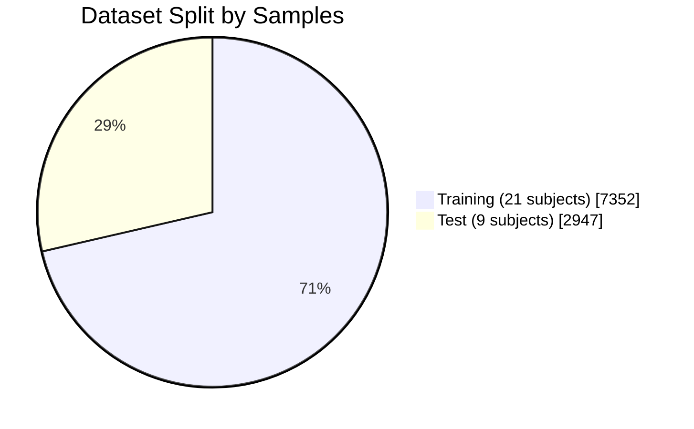
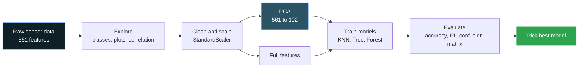
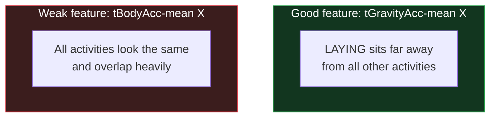
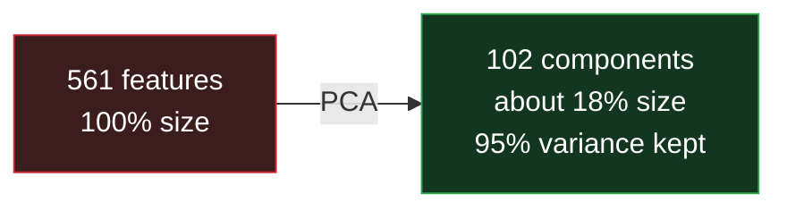
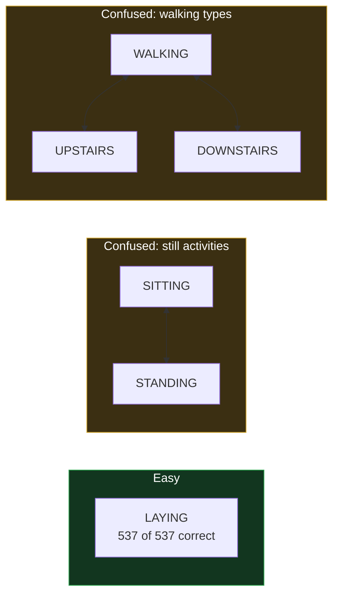

<div align="center">


<a href="https://github.com/AbdulAzeemHashmi/human-activity-recognition-ml">
  
</a>

<br/>


</div>

---

## Table of Contents

- [About the Project](#about-the-project)
- [The Big Picture](#the-big-picture)
- [Dataset](#dataset)
- [Project Workflow](#project-workflow)
- [Repository Structure](#repository-structure)
- [Step 1: Data Exploration](#step-1-data-exploration)
- [Step 2: Data Preprocessing](#step-2-data-preprocessing)
- [Step 3: Models](#step-3-models)
- [Step 4: Evaluation](#step-4-evaluation)
- [Step 5: Insights](#step-5-insights)
- [Final Choice](#final-choice)
- [Limitations and Future Work](#limitations-and-future-work)
- [How to Run](#how-to-run)
- [Tools Used](#tools-used)
- [Author](#author)

---

## About the Project

A fitness wearable must know what the user is doing: walking, climbing stairs, sitting, standing, or lying down. It reads motion sensors (accelerometer and gyroscope) from a smartphone worn at the waist.

There is one problem. The wearable has **limited memory and battery**. So the goal is not only high accuracy. The goal is a **small, fast and reliable model**.

This project does the following:

- Explores the sensor data and finds which features separate the activities.
- Uses **PCA** to cut the number of features and checks what it does to accuracy and speed.
- Trains **KNN**, **Decision Tree** and **Random Forest** on both full and reduced features.
- Compares accuracy, training time and prediction time.
- Explains which activities are easy, which are confused, and why.

---

## The Big Picture

| Item | Value |
|---|---|
| Task | Multi-class classification (6 activities) |
| Training samples | 7352 |
| Test samples | 2947 |
| Original features | 561 |
| Features after PCA | 102 (95% variance kept) |
| Feature reduction | About 82% |
| Best model | Random Forest on full features |
| Best accuracy | **92.60%** |

### Activities to recognize

| Icon | Activity | Type |
|:---:|---|---|
|  | WALKING | Moving |
|  | WALKING_UPSTAIRS | Moving |
|  | WALKING_DOWNSTAIRS | Moving |
|  | SITTING | Still |
|  | STANDING | Still |
|  | LAYING | Still |

---

## Dataset

The data is the **Human Activity Recognition Using Smartphones** dataset from Kaggle. It comes from 30 people who wore a smartphone at the waist while doing the six activities.

| File | Link |
|---|---|
| Train data | [train.csv](https://www.kaggle.com/datasets/uciml/human-activity-recognition-with-smartphones?select=train.csv) |
| Test data | [test.csv](https://www.kaggle.com/datasets/uciml/human-activity-recognition-with-smartphones?select=test.csv) |

Quick facts:

- **561 features** made from accelerometer and gyroscope signals.
- **No missing values** in train or test data.
- Classes are fairly balanced (986 to 1407 samples per class), so **accuracy is a fair metric**.
- **Train has 21 subjects and test has 9 different subjects.** No person appears in both. This tests the model on new users, so the original split was kept.



---

## Project Workflow



---

## Repository Structure

```text
human-activity-recognition-ml/
|
|-- human-activity-recognition.ipynb          # Main notebook (code, plots, results)
|-- human-activity-recognition-report.pdf     # Written report with figures and conclusions
`-- README.md                               
```

| File | What it contains |
|---|---|
| `human-activity-recognition.ipynb` | Full code: exploration, scaling, PCA, models, evaluation |
| `human-activity-recognition-report.pdf` | Short report that explains what was done, why, and what was learned |

> The notebook reads `train.csv` and `test.csv` from `/content/`. Download them from Kaggle (links above) and place them there, or change the path in the first code cell.

---

## Step 1: Data Exploration

<details open>
<summary><b>What was checked</b></summary>

<br/>

- The data has **7352 training** and **2947 test** samples, **561 features** and **6 classes**.
- The classes are fairly balanced, so accuracy is a fair metric.
- **Box plots** show which features help:
  - `tGravityAcc-mean()-X` separates **LAYING** clearly from all other activities.
  - `tBodyAcc-mean()-X` looks almost the same for every activity, so it separates them poorly.
- Many features are **redundant**. 56 of the first 100 features have correlation above 0.9 with another feature.
- The data comes from 30 people and the train and test subjects do not overlap.

</details>

### What a good feature looks like



---

## Step 2: Data Preprocessing

| Task | Decision | Why |
|---|---|---|
| Missing values | None found | Nothing to fix |
| Scaling | `StandardScaler`, fitted on **train only** | PCA and KNN depend on distance and variance. Fitting on train only avoids data leakage |
| PCA | Keep **102 components** | They hold 95% of the variance |
| 2D view | First two components | To see how well activities separate |

### PCA in one picture



In the 2D PCA plot:

- Moving activities are separated from still activities.
- Sitting, standing and laying overlap.
- The three walking types overlap partly.

---

## Step 3: Models

Three models were trained on the **full features (561)** and on the **PCA features (102)**.

| Model | Setting |
|---|---|
| KNN | k = 5 |
| Decision Tree | max depth = 10 |
| Random Forest | 100 trees, random state 42 |

### Results

Times are in seconds from a single run on Google Colab. Prediction time is for the whole test set.

| Model | Features | Accuracy | Train time | Predict time |
|---|---|---:|---:|---:|
| KNN | Full (561) | 88.36% | 0.085 | 3.185 |
| KNN | PCA (102) | 87.68% | 0.089 | 0.841 |
| Decision Tree | Full (561) | 86.66% | 7.984 | 0.005 |
| Decision Tree | PCA (102) | 76.25% | 1.341 | 0.003 |
| Random Forest | Full (561) | **92.60%** | 22.376 | 0.052 |
| Random Forest | PCA (102) | 88.16% | 12.482 | 0.054 |

### Accuracy at a glance

```mermaid
xychart-beta
    title "Accuracy by Model (blue = full features, orange = PCA 102)"
    x-axis ["KNN", "Decision Tree", "Random Forest"]
    y-axis "Accuracy (%)" 70 --> 95
    bar [88.36, 86.66, 92.60]
    bar [87.68, 76.25, 88.16]
```



---

## Step 4: Evaluation

Accuracy was used for all models. For the best model (Random Forest on full features), the **per class report** and a **confusion matrix** were also used, because accuracy alone hides which classes get mixed up.

### F1 score per activity (Random Forest, full features)

| Activity | F1 score | Level |
|---|---:|---|
| LAYING | 1.00 | `##########` |
| WALKING | 0.92 | `#########.` |
| STANDING | 0.91 | `#########.` |
| WALKING_DOWNSTAIRS | 0.91 | `#########.` |
| SITTING | 0.90 | `#########.` |
| WALKING_UPSTAIRS | 0.90 | `#########.` |

Overall accuracy: **92.6%**. Every class has an F1 score of 0.90 or more.

### Main confusions

| Actual | Predicted as | Count |
|---|---|---:|
| SITTING | STANDING | 52 |
| STANDING | SITTING | 42 |
| WALKING_UPSTAIRS | WALKING | 39 |

### Why 102 components?

Only one PCA setting (102 components) was tested. It was chosen as the trade-off because it keeps **95% of the variance** and cuts the features by about **82%**.

---

## Step 5: Insights

### Easy and hard activities



- **LAYING is easy.** The gravity direction changes completely when the body is flat.
- **SITTING and STANDING are confused.** The phone is at the waist and the body is almost still in both cases.
- **Walking types are confused.** Their motion looks similar.

### Model comparison

| Model | Strengths | Weaknesses |
|---|---|---|
| KNN | Trains instantly. Easy to explain | Slow prediction. Must store all training data |
| Decision Tree | Easiest to explain. Fastest prediction | Least accurate, especially with PCA |
| Random Forest | Most accurate. Fast prediction. Stable | Slowest training. Larger model |

### What PCA did

| Model | Effect of PCA |
|---|---|
| KNN | About **4 times faster** prediction, only 0.7% accuracy loss |
| Random Forest | Training time dropped from 22.4 s to 12.5 s, accuracy dropped 4.4% |
| Decision Tree | Accuracy dropped 10.4% |

PCA keeps the large variance that separates still and moving activities. It loses small details that separate similar classes, such as sitting and standing.

---

## Final Choice

<div align="center">

### Random Forest on full features


</div>

- It has the **highest accuracy** and an F1 score of 0.90 or more for every class.
- As an ensemble of many trees, it is **more stable** than one Decision Tree and beats KNN.
- **Prediction is very fast**, and it does not store the training data.
- Its slow training happens **once on a computer**, not on the device.
- If memory is very tight, **Random Forest on PCA features (88.2%)** is a lighter option.

---

## Limitations and Future Work

**Limitations**

- Only one PCA setting (102 components) was tested.
- Logistic Regression, Bagging and Boosting were not run in the notebook.
- Timings come from a single run.
- New users or a different sensor position may reduce accuracy.

**Future work**

- [ ] Test many PCA component counts and plot accuracy and time against them.
- [ ] Add Logistic Regression and Boosting.
- [ ] Reduce the number of trees to save memory.
- [ ] Test on data from new users and different sensor placements.

---

## How to Run

### Option 1: Google Colab (easiest)

1. Download `train.csv` and `test.csv` from the Kaggle links in the [Dataset](#dataset) section.
2. Open `human-activity-recognition.ipynb` in [Google Colab](https://colab.research.google.com/).
3. Upload both CSV files to the Colab file panel (they will appear in `/content/`).
4. Choose **Runtime**, then **Run all**.

### Option 2: Run on your computer

```bash
# 1. Clone the repository
git clone https://github.com/AbdulAzeemHashmi/human-activity-recognition-ml.git
cd human-activity-recognition-ml

# 2. Install the libraries
pip install pandas numpy matplotlib seaborn scikit-learn jupyter

# 3. Put train.csv and test.csv in the project folder
#    and change the file paths in the first code cell of the notebook

# 4. Start the notebook
jupyter notebook human-activity-recognition.ipynb
```

---

## Tools Used

| Tool | Use |
|---|---|
| Python | Main language |
| Pandas and NumPy | Data loading and math |
| Matplotlib and Seaborn | Charts and heatmaps |
| scikit-learn | Scaling, PCA, models and metrics |
| Jupyter and Google Colab | Writing and running the notebook |

---

## Author

<div align="center">

**Abdul Azeem**

[](https://github.com/AbdulAzeemHashmi)

If this project helped you, please give it a star.


</div>
